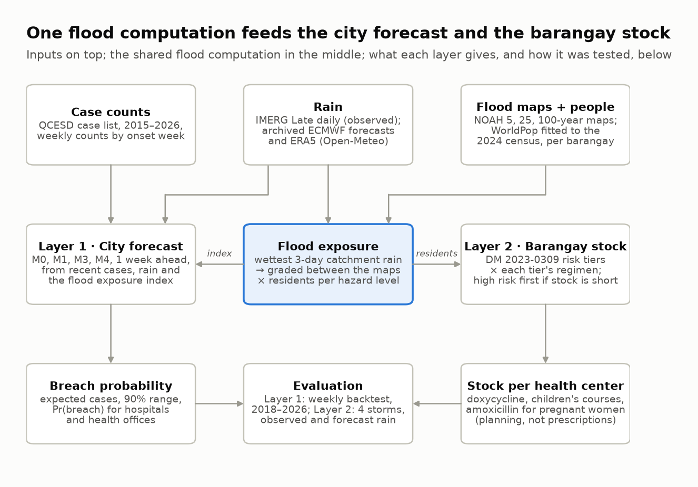
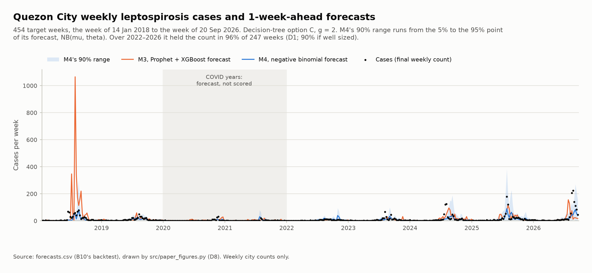

# Project LEPTON

**Leptospirosis Exposure Prediction & Targeting Operational Network**

LEPTON is built for the whole Philippines. It forecasts a city's leptospirosis cases a week ahead
and turns a storm's rain into prophylaxis stock for each barangay and health center, and every
input it needs except the case counts comes from national or global sources. This first version
runs in Quezon City, the country's most populous city ([Why Quezon City
first](#why-quezon-city-first)). It was built for PJDSC 2026. A research paper written alongside
the code, in [`paper/`](paper/), sets out the method, the tests and the results in full
([The paper](#the-paper)).

> [!IMPORTANT]
> **Stock planning, not prescriptions.** Every dose figure in this repository, its results and
> its app is a stock-planning figure for a health office. DOH Department Memorandum 2023-0309
> requires a physician's consultation before anyone takes prophylaxis.

<!-- The app's production link goes here once Vercel is set up (app/README.md, "Deploy (Vercel)"). -->

**Contents:** [Why](#why) · [What LEPTON does](#what-lepton-does) ·
[Why Quezon City first](#why-quezon-city-first) · [Results](#results) ·
[The paper](#the-paper) · [Quick start](#quick-start) · [Getting the data](#getting-the-data) ·
[Repository layout](#repository-layout) · [Documentation](#documentation) ·
[Methods in brief](#methods-in-brief) · [Safeguards and sanity checks](#safeguards-and-sanity-checks) ·
[Working on the code](#working-on-the-code) ·
[Data sources and licenses](#data-sources-and-licenses) · [License](#license)

## Why

Leptospirosis is a bacterial infection caught from floodwater or soil contaminated by the urine
of infected animals, especially rats. In Quezon City, as across Metro Manila, cases surge in the
weeks after a typhoon or a monsoon flood.

Two warnings would help a city health office. A few days' notice before a storm lets it send
doxycycline to the barangays most likely to flood; a week's notice of the cases that follow lets
hospitals prepare. Standard forecasting models smooth over the sharp post-storm spikes that
define leptospirosis outbreaks, so they cannot tell a health office where to position
prophylaxis. LEPTON gives both warnings, for any city in the country, from one shared flood
computation.

## What LEPTON does



*One flood computation feeds both layers. Drawn by `src/diagrams.py`; the paper's Figure A1.*

**The shared flood computation.** Rain over the catchments that drain into a city (for Quezon
City, the Marikina, San Juan and Tullahan rivers) is set against that rain's own history: a
storm as rare as a 5-, 25- or 100-year rain is matched with Project NOAH's flood map for that
return period, and a storm between two of them falls between the two maps. WorldPop's population
grid, fitted to the 2024 census, then gives the residents of each barangay in each flooded zone.
The share of the city's residents in those zones is the **flood exposure index** (EI).

**Layer 1, the city forecast.** Every week, for the week after: expected cases, a 90% range and
the probability that cases cross the epidemic threshold. The proposed model, **M4**, is a
negative binomial regression on the season, recent cases, the last two weeks' rain and the flood
exposure index. It is tested against two seasonal baselines and a reproduction of a published
Prophet–XGBoost hybrid in a weekly backtest, 2018–2026, on Quezon City's own case counts.

**Layer 2, barangay stock.** Exposed residents are split into children, pregnant women and
adults, and adults into DOH DM 2023-0309's risk tiers (a flood of 2 days or more makes every
exposed adult high risk). Each tier's regimen gives the doxycycline 100 mg capsules, children's
courses and amoxicillin 500 mg tablets each barangay needs, then each health center, with the
high-risk tier served first when stock runs short. Layer 2 needs no case data. It runs on the
rain that fell (NASA IMERG) and on ECMWF forecasts issued 1, 2 and 3 days before each storm.

**The app.** A web map of the Philippines (only Quezon City has data yet) shows the weekly
forecast, compares the models, and plays each storm's prophylaxis plan barangay by barangay, with
a stock list per health center to download. Clicking a barangay opens its numbers and a
**Generate Report** button, which saves a PDF report for its health office: the stock to prepare,
the health centers that hold it, a map, and how the figures were made. A guide for residents ("I
have been exposed to floodwater") finds the nearest health center without storing or sending
anything. See [`app/README.md`](app/README.md).

## Why Quezon City first

LEPTON is designed for every city in the Philippines. Apart from the case counts, its inputs come
from national or global sources: NASA IMERG, ERA5 and ECMWF rain; the WorldPop population grid;
PSA's census and birth tables; the national barangay boundaries; the DOH health facility
registry; HydroBASINS river basins; and Project NOAH's flood maps, which cover most provinces
(the app's map already draws them for the whole country). What a city has to supply is its own
weekly case counts. This first version runs in Quezon City for two reasons:

1. **A big city with an up-to-date case list.** Quezon City is the most populous city in the
   country, with 3,084,270 residents in the 2024 census, and its Epidemiology and Surveillance
   Division (QCESD) keeps a current list of its leptospirosis cases, each with its date of
   onset, from January 2015 to October 2026.
2. **Time.** LEPTON was built in under two weeks for PJDSC 2026, and formal requests for case
   data take weeks, so there was time to ask one city only. Even that was a gamble: without
   QCESD's reply, the city forecast would have fallen back to national weekly counts, without
   the flood features. QCESD answered, and its list arrived on 20 October 2026.

To add a city, LEPTON needs its weekly case counts and its own settings in
[`config.py`](config.py), where almost everything particular to Quezon City sits: the river
outlets that define its catchments, the box its rain is read over, its PSGC codes and census
totals, its names in the facility registry and the births table, and its storms. The sanity
checks hold Quezon City's own values too (142 barangays, for one), so a new city needs its own
pass values. Layer 2 needs no case data, so a city's stock plan can come before its case counts
do. Cebu City is next in line, as the paper's future work says. Until then, every result here is
Quezon City's, and may not carry over to cities with different drainage, climate or reporting.

## Results

Every number here comes from the committed files in [`results/`](results/). The paper's results
section reports them in full, with every test.

### Layer 1: next week's cases

The backtest made one forecast a week, for the weeks of 14 January 2018 to 20 September 2026:
454 forecasts. Each used only what the health office would have had: counts by week of symptom
onset, with the latest two weeks hidden from every model, as if not yet reported (the delay
guard, g = 2). The headline scores leave out the COVID-19 years 2020–2021, which leaves 349
weeks.

| Model | What it is | Average miss, cases a week (MAE, 349 weeks) | 95% interval | 90% range held the count (2022–2026) | Brier skill score (2022–2026) |
| --- | --- | ---: | :---: | ---: | ---: |
| M0 | The count in the same week last year | 9.30 | 4.77–13.79 | 73% | 0.03 |
| M1 | The average of the same week in recent years | 8.55 | 4.42–12.15 | 94% | 0.17 |
| M3 | Prophet + XGBoost hybrid (Latigay & Gonzaga, 2026), reproduced | 15.59 | 6.38–27.62 | 87% | 0.11 |
| **M4** | **Negative binomial regression, proposed** | **6.70** | **3.69–9.54** | **96%** | **0.34** |
| M4 without EI2 | M4 without the flood exposure index | 6.86 | 3.79–9.69 | 96% | 0.34 |

A well-sized 90% range holds the count in 90% of weeks, so M4's is slightly wide. The Brier
skill score rates the breach probabilities: above 0 beats always quoting the usual breach rate,
and 1 is perfect. Sources: `results/d8_fig2_mae.csv` and `results/d1_scores.csv`.

- **Primary endpoint.** M4 missed by 8.88 fewer cases a week than M3: the mean of
  |error of M4| − |error of M3| is −8.88, with a 95% moving-block bootstrap interval of −19.93 to
  −1.88 (8-week blocks, 2,000 resamples). It holds with 4- and 13-week blocks, and with the
  guard at g = 1 and g = 3 (`results/d5_guard_reruns.csv`). Much of the gap is 2018, when M3's
  forecasts ran away during the July outbreak (MAE 50.4 against M4's 7.4), but M4 still missed
  less than M3 in five of the six other scored years (`results/d1_mae_by_year.csv`).
- **Practical test.** M4 also beat the seasonal average M1, by 1.84 cases a week (interval
  −3.28 to −0.25).
- **Flood test.** The flood exposure index did not measurably improve M4: −0.15 cases a week
  (interval −0.50 to 0.21), at every guard. The flood maps earn their place in Layer 2.
- **Benchmark reproduction.** M3's Prophet step came within 4.4% of the published MAE (24.73
  against 23.68), but the hybrid's published gain could not be reproduced (24.60 against 16.72;
  none of 75 XGBoost settings came within 10%). M4 is compared with this reproduction, not with
  the published figure: [`results/m3_reproduction.md`](results/m3_reproduction.md).



### Layer 2: stock for four storms

On the rain that fell (IMERG), at full coverage: every exposed resident counted, every course
taken. **Stock-planning figures, not prescriptions.**

| Storm | Flood days (D) | Wettest 3-day rain over the catchments | Residents in flooded zones (EI) | Exposed residents | Doxycycline 100 mg capsules | Children's courses | Amoxicillin 500 mg tablets |
| --- | ---: | ---: | ---: | ---: | ---: | ---: | ---: |
| Typhoon Carina, July 2024 | 3 | 120.0 mm | 0.05% | 1,414 | 1,893 | 457 | 67 |
| July 2025 floods | 6 | 191.0 mm | 13.1% | 404,966 | 542,106 | 130,719 | 19,169 |
| August 2026 habagat floods | 4 | 141.0 mm | 4.0% | 124,765 | 167,017 | 40,273 | 5,906 |
| Severe Tropical Storm Kristine, October 2024 | 1 | 195.1 mm | 13.8% | 425,192 | 1,707,544 | 137,248 | 20,126 |

Kristine's flood lasted a day, so its adults split between DM 2023-0309's low and moderate
tiers by w, the share with a wound or floodwater in the eyes, nose or mouth. The table uses
w = 0.5; w = 0 gives 569,182 capsules and w = 1 gives 2,845,907. Source:
`results/d8_fig5_doses.csv`; per barangay and per health center, `results/c8_*`, `c9_*` and
`d7_*`.

- **Satellite rain under-reads typhoon peaks.** IMERG puts Carina's rain at the no-flood floor,
  so its observed run sizes almost no stock. The ECMWF forecast issued a day ahead saw a 5- to
  25-year storm, with 24.6% of residents in flooded zones. Kristine, which IMERG does register,
  was added as a fourth storm for that reason; it was not in the proposal.
- **Forecasts 1 to 3 days ahead** put 25.6%, 15.2% and 13.1% of residents in flooded zones for
  Kristine (13.8% on observed rain), but fell short for the long July 2025 floods (4.7%, 1.2% and
  0%, against 13.1%). Each rain product is set against its own return levels: forecasts against
  ERA5's, observed rain against IMERG's (`results/c9_forecast_runs.csv`).
- **These runs are demonstrations, not validations.** No barangay case counts were available to
  test them against.

### Limits

- One city so far ([Why Quezon City first](#why-quezon-city-first)): the results are Quezon
  City's, from one source of case counts, its surveillance division.
- The backtest scores final counts behind a 2-week guard. Real-time accuracy may be lower,
  because real counts are still filling in when the forecast is made.
- M4's outbreak alarms are seldom false (73% of them came true) but caught only 4 of 14
  outbreak episodes in advance, against 9 for the seasonal average M1
  (`results/d3_alarms.csv`).
- Layer 2 rests on satellite rain that under-reads typhoon peaks, on NOAH maps that state no
  design rain duration, and on a no-flood floor (half the 5-year rain) that was not tuned.
- The full list is in the paper's scope and limitations, and in [`Notes.md`](Notes.md),
  section 3.

## The paper

The project is supported by a research paper, *Project LEPTON: Leptospirosis Exposure Prediction
and Targeting Operational Network*, written alongside the code. The repository is the working
system; the paper is the case for it: why the problem matters, how the method was built, how it
was tested, what the tests found and what they cannot claim. Its LaTeX source is in
[`paper/`](paper/).

| Part | What it covers |
| --- | --- |
| Executive summary | The project and its main results, in under 250 words |
| Background, problem, objectives | Leptospirosis after floods in Quezon City, why current forecasts fall short, and the four objectives as they were tested |
| Scope and limitations | What was built, what was left as future work, and what the results cannot claim |
| Methodology | The data, the shared flood computation, both layers and the evaluation, in words (the formulas are in an appendix) |
| Results | The forecast scores and their tests, the sanity checks, the four storm runs and the figures |
| References | 40 works in APA 7th edition, each DOI checked against Crossref or DataCite |
| Appendices A–E | The study design and Layer 1's steps; the models; every assumption, with its `config.py` name and how it was tested; every formula, with the `src/` file that computes it; the data sources with their download dates |

Every number in the paper comes from `results/`, `config.py` or a note in `data/raw/`, and a
comment at the top of each section names its files, so the paper can be checked against a
rebuild of the code. The PDF is not kept in git: build it from `paper/` on Overleaf or with
`latexmk` ([Quick start](#6-build-the-paper)).

## Quick start

Run every command from the repository root unless it says otherwise.

### 1. Look without installing anything

- [`results/`](results/) holds every result: `forecasts.csv` (every model's forecast for every
  week), the score tables (`d1_*`, `d3_*`, `d5_*`), the storm runs (`c8_*`, `c9_*`, `d7_*`) and
  the paper's figures (`d8_fig*`, `e8_fig*`).
- [`app/public/data/`](app/public/data/) holds the files the app draws (JSON and GeoJSON).
- [`data/raw/`](data/raw/) holds a note per data source: where it came from, when, and how to
  download it again.

### 2. Set up Python

Install Python 3.13, the version `requirements.txt` is pinned for. Then make a virtual
environment and install the packages:

```
python -m venv .venv
.venv\Scripts\activate            (Windows; on macOS or Linux: source .venv/bin/activate)
pip install -r requirements.txt
```

On Windows, keep the repository in a short path, or turn on Windows long paths: a virtual
environment in a very deep folder fails with "DLL load failed ... The filename or extension is
too long" when importing netCDF4, shapely or rasterio. Prophet prints "Importing plotly failed.
Interactive plots will not work." when it loads; that is harmless.

### 3. Run the sanity checks

```
python -m src.checks
```

Each check prints PASS, SKIP (its data file is not on this computer) or FAIL. A FAIL stops work
until it is fixed; rerun the checks after any change. With the full data on disk they take about
3 minutes. [Safeguards and sanity checks](#safeguards-and-sanity-checks) says what they prove.

### 4. Rebuild everything

One command reruns every step in order from the files in `data/raw/`, then the checks:

```
python -m src.run_all --list          # the steps in order, and which are skipped and why
python -m src.run_all                 # run them all, then python -m src.checks
python -m src.run_all --fetch-imerg   # also download IMERG rain first (needs an Earthdata login)
python -m src.run_all --simulate      # the city forecast on made-up counts, without the case data
```

- With the data already downloaded, a full run took about 40 minutes on a laptop (October 22,
  2026). Most of it is the backtest's three runs, one per delay guard, about 12 minutes each,
  because M3 refits Prophet every week. The first run also downloads what is missing: NOAH's
  maps can take over an hour.
- If a step fails, the run stops there and prints the command that resumes from it. Before the
  first step it checks the files saved by hand (HydroBASINS, the census files, the Mendeley
  file, PSA births) and `data/raw/imerg_daily.nc`, and lists any that are missing
  ([Getting the data](#getting-the-data)).
- Downloads: WorldPop, NOAH's maps, the facility registry, ERA5 and the archived ECMWF forecasts
  are fetched only when they are not already in `data/raw/`. IMERG always fetches up to today
  and needs an Earthdata login, so it runs only with `--fetch-imerg`.
- Quezon City's case data: the step that turns QCESD's case list into weekly counts runs only
  when the list is in `data/raw/qcesd/`. The list is case-level and stays on the team drive
  (safeguard 11), so in any other copy that step is skipped, not stopped. The backtest then runs
  on `data/clean/cases_weekly.csv` if it was copied from the drive, and is skipped if not.
  Without `cases_weekly.csv`, the residual check (`python -m src.m4`) and the score tables
  (`python -m src.score_tables`) are skipped too, and the app's export leaves
  `city_forecast.json` and `scores.json` as they were; the paper's figures are still drawn,
  from the committed `results/forecasts.csv`.
- `--simulate` runs the city forecast on made-up counts shaped like Quezon City's and draws the
  forecast figures as previews from them (`results/d8_preview_*`). The app's export still uses
  the committed `results/forecasts.csv`; only a copy without that file gets a
  `city_forecast.json` marked `"simulated": true`. It tests the whole chain; none of it is a
  result.
- One check confirms what the repository ships: every package pinned in `requirements.txt` and
  installed at that version, nothing tracked under `data/` but the notes, and no tracked table
  with a person's columns (safeguard 11).
- Three app-only steps are not in `run_all`: `python -m src.app_simulation` (the map's Simulation
  mode), `python -m src.app_days` (a prophylaxis plan for every day, run on the same day) and
  `python -m src.noah_national` (NOAH's maps for the whole country). All three are in
  [`app/README.md`](app/README.md).
- M3's Prophet fit can differ slightly from one computer to another, so a rerun elsewhere may not
  match M3's committed forecasts, or the scores built on them, to the last digit.

### 5. Run the app

The app's data files are committed, so it runs from a fresh clone without Python. It needs
Node.js 22.12 or newer:

```
cd app
npm install      # once
npm run dev      # http://localhost:5173
```

| Address | What it shows |
| --- | --- |
| `/` | Home: the project, the latest forecast and a storm's stock plan |
| `/map` | The map of the whole Philippines; Quezon City is the first city with data |
| `/map/quezon-city` | Next week's forecast for Quezon City, any week since 2018 (`?date=2024-10-22`) |
| `/map/quezon-city/compare` | The five models' forecasts and scores |
| `/map/quezon-city/prophylaxis?date=2024-10-22` | Kristine's prophylaxis plan per barangay and health center, 1 to 3 days ahead; click a barangay for its PDF report |
| `/exposed` | The "I have been exposed to floodwater" guide for residents |
| `/leptospirosis` | Leptospirosis explained for residents, each fact linked to its DOH source |
| `/how-it-works` | The pipeline, models, tests, limits and sources |

The map opens in **Simulation** mode, which extends the weeks past QCESD's last count with
made-up counts, each marked with an amber "Simulated" badge; **Real data** (`?data=real`) shows
only the counts and the backtest's forecasts. `npm run build` writes the site to `app/dist/`, and
`npm run preview` serves it as Vercel would. The screens, data files and deployment are in
[`app/README.md`](app/README.md).

### 6. Build the paper

On [Overleaf](https://www.overleaf.com): zip the `paper/` folder, then New Project → Upload
Project; in Menu, set the compiler to pdfLaTeX and the main document to `main.tex`. With a TeX
installation (TeX Live, TinyTeX or MiKTeX), from `paper/`:

```
latexmk -pdf main.tex
```

[`paper/README.md`](paper/README.md) has the step-by-step setup on Windows and in VS Code, which
file holds which section, and the rules for writing in it.

## Getting the data

Data files are not in git: they are large, and the case data must never be published. Each
source has a note in [`data/raw/`](data/raw/), `<file>.md`, with its URL, download date, version
and citation, so anyone can fetch it again. Teammates copy the files from the team drive
instead.

| How the file arrives | Files |
| --- | --- |
| Downloaded by its script when missing | WorldPop, NOAH's maps, the health facility registry, ERA5, ECMWF's archived forecasts, the city outlines |
| Downloaded with a free NASA Earthdata login | IMERG daily rain: `python -m src.imerg`, steps at the top of `src/imerg.py`, or `run_all --fetch-imerg` |
| Saved by hand, link in the note | HydroBASINS (`hybas_au_lev12_v1c.md`), the barangay boundaries (`phl_admin_boundaries.gdb.zip.md`), the 2020 and 2024 census tables (their `.xlsx.md` notes), the national weekly cases (`parreno.md`), PSA births (`psa_births_2024.csv.md`, a `curl` command) |
| Not public | QCESD's case list (`qcesd.md`), one row per case, on the team drive only |

**Quezon City's case data.** The Quezon City Epidemiology and Surveillance Division (QCESD)
shared its case list for this project. It is a case-level record, so it never enters this
repository (safeguard 11): it lives only on the team drive, saved as
`data/raw/qcesd/qcesd_case_list.xlsx`. QCESD allowed the weekly city totals to be published, and
those are the `y` column of `results/forecasts.csv` and of the app's `city_forecast.json`.
Without the list, every other step still runs: copy `data/clean/cases_weekly.csv` from the drive
to rerun the backtest, or use `--simulate` to run the city forecast on made-up counts.

## Repository layout

```
config.py          every date, path and assumption value; no number is written anywhere else
requirements.txt   the Python packages, pinned (Python 3.13)
src/               the pipeline: one module per step, each run as python -m src.<module>
  run_all.py       reruns every step in order
  checks.py        the sanity checks
data/raw/          downloads, saved unchanged (not in git); a note <file>.md per source
data/clean/        processed files (not in git)
results/           every result: forecasts, scores, storm runs, figures
app/               the web app (React, TypeScript, Vite, MapLibre); app/public/data/ is its data
paper/             the research paper (LaTeX)
notebooks/         exploration only; nothing a result depends on
Notes.md           the team's decisions, departures from the plan, limitations and their sources
LICENSE            MIT, for the code
```

The modules in `src/`, by stage:

| Stage | Modules |
| --- | --- |
| Data | `weeks` (the week calendar), `catchments` (river basins), `imerg`, `era5`, `ecmwf` (rain), `census`, `worldpop` (people), `noah` (flood maps), `facilities` (health centers), `benchmark` (national cases), `cases` (Quezon City's cases) |
| Flood computation and Layer 2 | `rescale`, `overlay`, `flood_exposure`, `shares`, `exposed`, `doses`, `allocation`, `observed_run`, `forecast_run` |
| Layer 1 | `population`, `features`, `view` (what a model may see), `baselines` (M0, M1), `m3`, `m3_port` (M3), `m4`, `forecast_range`, `thresholds`, `backtest` |
| Evaluation and figures | `scores`, `breach_scores`, `compare`, `score_tables`, `layer2_results`, `paper_figures`, `diagrams` |
| App data | `app_data`, `app_simulation`, `app_days`, `noah_national` |
| Running and checking | `run_all`, `checks` |

Functions carry docstrings that state their formulas in plain words.

## Documentation

| Where | What |
| --- | --- |
| [`paper/`](paper/) | The research paper: the full method, results and limitations ([The paper](#the-paper)) |
| [`Notes.md`](Notes.md) | The team's decisions, every place the code departs from the original plan and why, and the limitations with the papers behind them |
| [`results/m3_reproduction.md`](results/m3_reproduction.md) | How the M3 benchmark was reproduced, and why its hybrid's published gain could not be |
| [`data/raw/storm-facts.md`](data/raw/storm-facts.md) | The four storms: flood dates, days flooded and flooded barangays, each with its source |
| [`data/raw/*.md`](data/raw/) | One note per data source: URL, download date, version, checks and citation |
| [`config.py`](config.py) | Every date, path and assumption value, each with a comment |
| [`app/README.md`](app/README.md) | The app: its screens, data files, design tokens, maps, accessibility checks and deployment |
| [`paper/README.md`](paper/README.md) | How to build the paper, which file holds which section, and the rules for writing in it |

## Methods in brief

The paper's methodology gives the full method, and its Appendix D every formula.

**Conventions.**

- Weeks are CDC/MMWR epidemiological weeks, Sunday to Saturday (`epiweeks`), numbered
  continuously; for seasonal lookups week 53 counts as week 52.
- Rain days are UTC days (8 AM to 8 AM Philippine time), from IMERG Late daily (V07).
- Quezon City's counts are by week of symptom onset, with no report dates, so models see counts
  only up to 2 weeks before the forecast day (option C, g = 2; rerun with g = 1 and 3). Rain is
  never hidden: it is observed in real time.
- 2020 and 2021 are COVID-19 years: an indicator in M4, and left out of the thresholds' reference
  years and of the headline scores.
- The years 2015–2017 are burn-in; the backtest forecasts from 2018.

**The flood computation.** A storm's rain is its wettest 3-day total over the catchments, each
IMERG cell weighted by its area inside them. A Gumbel curve fitted to the yearly maxima of the
years before the storm (at least 10) gives the 5-, 25- and 100-year rain. Below the no-flood
floor, half the 5-year rain, nobody counts as exposed; between two return periods the exposed
residents are interpolated between the two maps; above the 100-year rain, the 100-year map
counts.

**The models.**

- **M0:** the count 52 weeks before the target week.
- **M1:** the mean of the same week of the year over the threshold's reference years.
- **M3** (Latigay & Gonzaga, 2026): Prophet (multiplicative seasonality, changepoint prior scale
  0.55), plus XGBoost trained on Prophet's in-sample misses with two features, Prophet's forecast
  and the ISO week; the forecast is Prophet's plus XGBoost's correction, never below 0.
- **M4:** a negative binomial regression with Quezon City's population as an offset, fitted with
  statsmodels at every forecast day:

```math
\log \mu_{T+1} = \log P_T + \beta_0 + \sum_{k=1}^{3}\left(\alpha_k \sin\frac{2\pi k t}{52.18} + \gamma_k \cos\frac{2\pi k t}{52.18}\right) + \rho \log(1 + \tilde{y}) + \beta_1 \frac{\mathrm{Rcum2}_T}{50} + \beta_2\, \mathrm{EI2}_T + \delta\, \mathrm{COVID}_{T+1}
```

  In plain words: expected cases = population × a base rate × the season × a recent-cases
  multiplier (ỹ, the two latest weeks the model may see) × a rain multiplier (Rcum2, the last two
  weeks' rain where people live) × a flood multiplier (EI2, the larger of this week's and last
  week's exposure index) × a COVID multiplier.

**Every forecast's range.** Each model's forecast is a negative binomial distribution around its
mean, as wide as that model's own last 104 misses outside the COVID years (with fewer than 26,
the training fit's spread). The 90% range runs from its 5% to its 95% point.

**The epidemic threshold.** For each week of the year, the mean plus 2 standard deviations of
that week over up to the 5 most recent complete non-COVID years (at least 3). A week breaches
when its count is strictly greater; Pr(breach) uses the same rule.

**The scores.** The primary endpoint is the mean of |error of M4| − |error of M3| over 2018–2019
and 2022–2026, with a moving-block bootstrap (8-week blocks, 2,000 resamples). Also: RMSE, bias,
MASE, the weighted interval score, 50% and 90% coverage, Brier scores, reliability, alarms and
lead times.

**Layer 2, step by step:**

1. Rescale WorldPop so each barangay adds up to its 2024 census total.
2. Count the residents of each barangay in each NOAH hazard level (up to 0.5 m, 0.5–1.5 m, over
   1.5 m) of each map, counting a pixel partly inside a zone in proportion.
3. Place the storm's rain against the return levels and interpolate the exposed residents.
4. Split them into children under 18 (2020 census ages), pregnant women (2024 births by the
   mother's residence × 0.75, split by each barangay's women aged 15–49) and adults.
5. Floods of 2 days or more make every exposed adult high risk; shorter floods split adults into
   moderate (a share w with a wound or floodwater in the eyes, nose or mouth) and low risk.
6. Turn people into units: doxycycline 100 mg capsules = 2 per low-risk adult + 10 per
   moderate-risk adult + 2 per week of flooding per high-risk adult; one children's course per
   week of flooding (at least one) per exposed child; 6 amoxicillin 500 mg tablets per exposed
   pregnant woman. **Stock planning, not prescriptions.**
7. Send each barangay's need to its health centers (66 get stock), high risk first when stock
   is short.
8. Run each storm on observed rain (IMERG, on IMERG's return levels), with the flood's real
   length D.
9. Run each storm on ECMWF forecasts issued 1, 2 and 3 days ahead (on ERA5's return levels),
   for a 1-day and a 7-day flood, since a forecast cannot know how long the flood will last.

## Safeguards and sanity checks

Each rule below prevents a known way for this kind of pipeline to give a wrong answer without an
error. The sanity checks test them.

1. **No leakage.** At forecast day T a model sees case counts only up to its cutoff (T − g).
   Training rows are built with the same lags they have at prediction time. Check S11 overwrites
   every count a model may not see with −999 and confirms the forecasts do not change.
2. Rain return levels are fitted only on years **before** the forecast or storm year, at least
   10 of them, and refitted at the first forecast day of each year.
3. Each rain product is judged on its own return levels: IMERG for observed rain, ERA5 for ECMWF
   forecasts. They are never mixed.
4. M4 uses statsmodels' `smf.negativebinomial`, which estimates the spread (the GLM family fixes
   it), with the population offset when fitting **and** when predicting.
5. The run stops if any forecast is NaN (a missing input gives NaN without an error), and every
   model is scored on exactly the same weeks.
6. A breach is a final count strictly greater than the threshold, for the forecast and for the
   scored outcome alike.
7. The exposure index divides by Quezon City's 2024 total from the same rescaled maps, not by
   that week's population.
8. IMERG files store longitude before latitude, so data are selected by dimension name, never by
   position.
9. M3 was rebuilt on its benchmark paper's own data and checked against the published scores
   before it was used on Quezon City; where it falls short, the gap is written down
   (`results/m3_reproduction.md`).
10. Dose figures are labelled stock planning, not prescriptions, wherever they are printed.
11. No case-level records in git: weekly counts only.

The checks in `src/checks.py` (`python -m src.checks`):

| Check | What passing proves |
| --- | --- |
| S1 calendar | Weeks follow CDC/MMWR: 9 August 2026 is 2026 week 32; 2020 and 2025 have 53 weeks |
| S2 rain file | IMERG has no fill or negative values and no missing day; Carina's days are among 2024's wettest |
| S3 census join | All 142 barangays match in the boundaries, the 2024 totals and the 2020 age tables |
| S4 cases file | One row per week, unconfirmed weeks missing (not 0), and QCESD's published 2025 total reproduced |
| S5 M4 simulation | M4 recovers known parameters from 50 simulated datasets, and its offset gives the true means |
| S6 theta | The forecast range's spread is recovered from 20,000 simulated counts |
| S7 breach, scores | Breach probabilities, the weighted interval score and outbreak episodes match hand-worked answers |
| S8 census fit, overlay | Each barangay's rescaled pixels add up to its census total; no barangay has more exposed residents than people |
| S9 return levels, exposure index | A known Gumbel curve gives 145.0, 196.0 and 238.0 mm at 5, 25 and 100 years; exposure interpolates exactly between the maps |
| S10 shares, exposed, doses, allocate | Shares add up to 1; 100 exposed adults at w = 0.5 need 600 capsules at D = 1, 200 at D = 3, 400 at D = 10; high risk is served first |
| S11 leakage | Hidden counts set to −999 change no forecast; every model has a forecast on every scored day; no NaN |

Further checks cover the storm facts, what each model may see, the baselines M0 and M1, M3's
weekly refits, MASE, lead time, the primary endpoint, the flood test, the score tables, the
app's data files, scores, flood tiles and simulation, and what the repository ships.

## Working on the code

For anyone extending the project:

- **Read [`Notes.md`](Notes.md) first:** the decisions taken, where the code departs from the
  original plan, and why.
- **No magic numbers.** Every date, path and assumption value lives in `config.py`, with a
  comment.
- **Run `python -m src.checks` after any change.** A FAIL stops work until it is fixed.
- **New data:** save the download unchanged in `data/raw/` with a note `<file>.md` (the template
  is in [`data/raw/README.md`](data/raw/README.md)); cleaned versions go in `data/clean/`.
- **Never commit case-level records** (safeguard 11). The submission names no team, school or
  member, as PJDSC's guidelines ask, so data notes say "a team member".
- The paper has its own writing rules ([`paper/README.md`](paper/README.md)), and the app its own
  conventions ([`app/README.md`](app/README.md)).

## Data sources and licenses

The code is under the [LICENSE](LICENSE) file's terms (MIT). The data keep their sources'
licenses. Files in `data/` are not in git; each has a note in `data/raw/<file>.md` with its
source, date and citation. Files the repository does ship that are built from these sources (in
`results/` and `app/public/data/`) keep the same terms.

| Data | Source | License | Credit |
| --- | --- | --- | --- |
| Flood hazard maps, 5-, 25- and 100-year | [Project NOAH](https://noah.up.edu.ph), UP Resilience Institute | [ODbL 1.0](https://opendatacommons.org/licenses/odbl/1-0/) | UP Resilience Institute / NOAH Center. Every result uses the Metro Manila maps; the app's flood layer, `app/public/data/noah_flood_*.pmtiles`, covers every province NOAH has mapped and is shared under the ODbL |
| Population, 100 m, 2024 (R2025A) | [WorldPop](https://hub.worldpop.org) | CC BY 4.0 | Bondarenko et al. (2025), WorldPop, University of Southampton |
| Barangay boundaries (COD-AB v03) | NAMRIA and PSA via [OCHA on HDX](https://data.humdata.org/dataset/cod-ab-phl) | CC BY-IGO | OCHA Philippines, from NAMRIA and PSA |
| Population by single-year age and sex, 2020 census | PSA via [OCHA on HDX](https://data.humdata.org/dataset/popn-single-year-age-sex-and-barangay-census-2020) | CC BY | OCHA Philippines, from PSA |
| Barangay population, 2024 census | [Philippine Statistics Authority](https://psa.gov.ph) | PSA terms of use | Philippine Statistics Authority, 2024 Census of Population |
| Registered live births, 2024 | [PSA OpenSTAT](https://openstat.psa.gov.ph) | CC BY ([OpenSTAT terms](https://openstat.psa.gov.ph/Terms)) | Philippine Statistics Authority |
| Health facilities | [DOH National Health Facility Registry](https://nhfr.doh.gov.ph) | No license stated (public registry) | Department of Health. Only facility names, codes and coordinates are kept; the registry's staff names and e-mails are not |
| Daily rain, IMERG Late V07 | [NASA GES DISC](https://doi.org/10.5067/GPM/IMERGDL/DAY/07) | NASA open data, no restrictions | Huffman et al. (2024), NASA/GSFC, archived at GES DISC |
| ERA5 hourly rain | ECMWF via the [Open-Meteo](https://open-meteo.com) Historical Weather API | CC BY 4.0 | Weather data by Open-Meteo.com (Zippenfenig, 2023); contains modified Copernicus Climate Change Service information (Hersbach et al., 2020) |
| ECMWF IFS forecasts | ECMWF via the [Open-Meteo](https://open-meteo.com) Previous Runs API (the storm runs) and Forecast API (the app's Simulation mode) | CC BY 4.0 | Weather data by Open-Meteo.com; ECMWF IFS open data |
| Sub-basins (HydroBASINS v1c, level 12) | [HydroSHEDS](https://www.hydrosheds.org) | HydroSHEDS license: free for scientific, educational and commercial use | Lehner & Grill (2013), Hydrological Processes 27(15) |
| National weekly cases, 2019–2023 | [Parreño (2023), Mendeley Data](https://doi.org/10.17632/v98325dpxv.1) | CC BY 4.0 | S. J. Parreño, Philippine Epidemiological Data, v1 |
| City and municipality outlines | [faeldon/philippines-json-maps](https://github.com/faeldon/philippines-json-maps) | MIT | (c) James Faeldon; the app's map of the Philippines (`ph_cities.json`, `ph_islands.json`) |
| QC leptospirosis cases, 2015–2026 | Quezon City Epidemiology and Surveillance Division (shared on request) | Not public | The case list never enters this repository (safeguard 11). Only weekly city totals are published, with QCESD's permission |
| App base maps | OpenFreeMap / OpenStreetMap; EOX Sentinel-2 cloudless 2024 | ODbL; CC BY-NC-SA 4.0 | © OpenStreetMap contributors; EOX IT Services, contains modified Copernicus Sentinel data |
| App terrain and live weather layers | Mapzen Terrain Tiles (Registry of Open Data on AWS); NASA GIBS (Himawari-9 infrared from JMA, IMERG, VIIRS); RainViewer | Each provider's terms (RainViewer: free for personal and educational use) | Credited in the app's footer and its How it works page |
| App photos and fonts | Wikimedia Commons; Google Fonts (Figtree, Instrument Sans) | CC BY 2.0 and CC BY-SA 4.0; SIL Open Font License | Each photo's author and license in the app's footer (`app/src/home/photos.ts`) |

## License

The code is released under the MIT License ([LICENSE](LICENSE)). The data keep their own
licenses ([above](#data-sources-and-licenses)); anything built from NOAH's maps is shared under
the ODbL. Thanks to the Quezon City Epidemiology and Surveillance Division for sharing the
city's case counts and allowing their weekly totals to be published.
